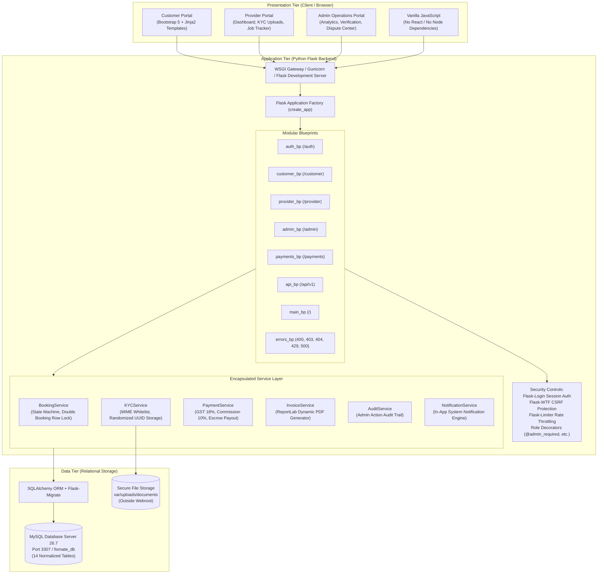
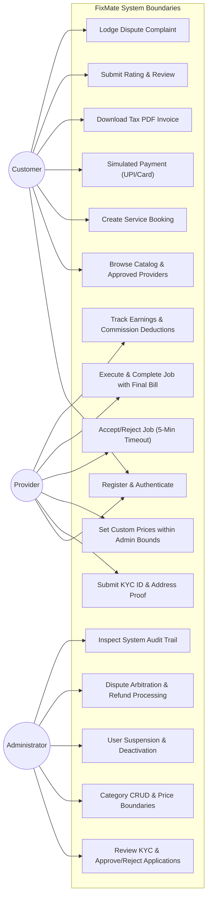

# FixMate — System Architecture & Design Documentation

## 1. System Overview
**FixMate** is a robust, responsive web-based Home Service Management System built for academic demonstration at **VESIT (Department of Computer Engineering)**. It connects residential customers with verified service professionals (electricians, plumbers, carpenters, technicians) while offering administrative governance over verification, pricing limits, commission collection, and dispute arbitration.

---

## 2. Three-Tier Architectural Pattern

FixMate adheres to a strict 3-tier architectural model:

---

## 3. Use Case Diagram

---

## 4. Software Design Patterns Applied

### 1. Application Factory Pattern
- **Implementation:** `app.create_app(config_name)` in `app/__init__.py`.
- **Academic Benefit:** Allows seamless environment switching between `development` (uses local development database) and `testing` (instantiates isolated `fixmate_test_db` for pytest runs with CSRF disabled).

### 2. Service Layer Pattern
- **Implementation:** Directory `app/services/`.
- **Reasoning:** Keeps controllers/blueprints lightweight. Complex business rules—such as state transition graphs, double-booking row locks, 7-day complaint windows, and 18% GST splits—are housed strictly in service classes (`BookingService`, `PaymentService`, `KYCService`), maximizing reusability and testability.

### 3. Repository / ORM Pattern
- **Implementation:** SQLAlchemy Declarative Models in `app/models/`.
- **Reasoning:** Abstracts raw SQL into object-oriented entities while enforcing database constraints (foreign keys, cascading deletions, unique constraints, and check bounds) natively in MySQL.

### 4. Adapter / Strategy Pattern for Payments
- **Implementation:** `PaymentService.process_simulated_payment()` with an extensible payment interface.
- **Reasoning:** Simulates real UPI, Debit/Credit Card, Net Banking, and Mobile Wallet flows for the live academic demo without requiring external paid gateway credentials. Structured so real Razorpay or Stripe webhooks can be plugged in without changing booking lifecycle logic.

### 5. Decorator Pattern for Access Control
- **Implementation:** `app/utils/decorators.py` (`@customer_required`, `@provider_required`, `@approved_provider_required`, `@admin_required`).
- **Reasoning:** Declarative role enforcement at the route level. Prevents privilege escalation and blocks unverified providers from accepting bookings.

