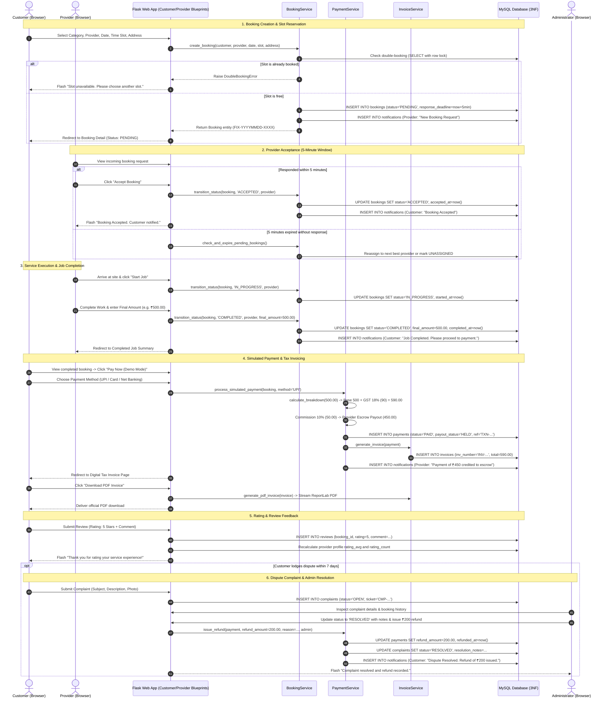
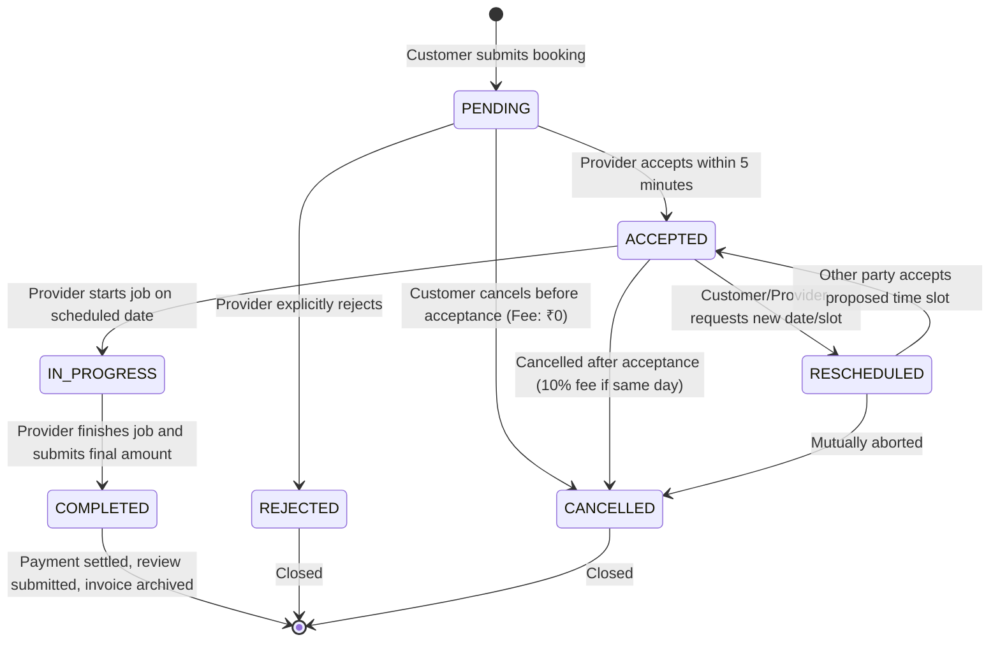

# FixMate — Booking Lifecycle & State Transitions

## 1. End-to-End Core Booking Sequence Diagram

---

## 2. Booking State Transition Diagram

### Transition Validation Matrix

| Current State | Target State | Permitted Actor | Validation Rules |
|---|---|---|---|
| `PENDING` | `ACCEPTED` | Provider | Response deadline must not have expired (< 5 mins). |
| `PENDING` | `REJECTED` | Provider | Provider declines job; customer notified immediately. |
| `PENDING` | `CANCELLED` | Customer | No penalty fee applied (`cancellation_fee = 0.00`). |
| `ACCEPTED` | `IN_PROGRESS` | Provider | Provider on-site; timer starts. |
| `ACCEPTED` | `RESCHEDULED` | Customer / Provider | Requires mutual agreement on new proposed slot. |
| `ACCEPTED` | `CANCELLED` | Customer | If cancelled on the same scheduled date, 10% penalty fee applied. |
| `RESCHEDULED` | `ACCEPTED` | Counterparty | Confirms rescheduled date/slot in provider calendar. |
| `IN_PROGRESS` | `COMPLETED` | Provider | Provider inputs final confirmed bill amount. |
| `COMPLETED` | *Any* | *None* | Terminal state. Review allowed; complaint allowed within 7 days. |

